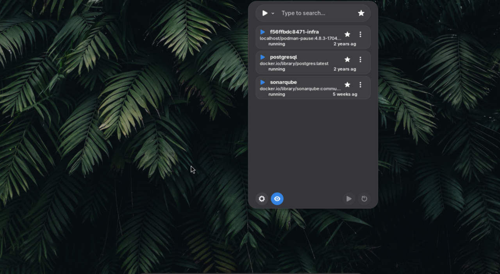

# Containers Manager

GNOME Shell extension to manage Podman or Docker containers from the top panel.

The interface is visually inspired by [Copyous](https://github.com/boerdereinar/copyous/), borrowing its compact modal layout and polished GNOME-oriented interaction style while remaining focused on container management.



## Requirements

- GNOME Shell 50
- Fedora 44 Workstation development environment
- Podman or Docker available on the host
- `mutter-devkit` for testing in a separate GNOME Shell session without logout

Install the debug shell helper:

```bash
sudo dnf install mutter-devkit
```

## Install or Update

The directory name is the extension UUID. GNOME Shell loads it from:

```text
~/.local/share/gnome-shell/extensions/containers-manager@giaffa86/
```

After editing files, sync the source tree and compile schemas:

```bash
rsync -av --exclude='.git' --exclude='AGENTS.md' --exclude='.agents' --exclude='.codex' \
  /path/to/containers-manager/ \
  ~/.local/share/gnome-shell/extensions/containers-manager@giaffa86/

glib-compile-schemas ~/.local/share/gnome-shell/extensions/containers-manager@giaffa86/schemas/
```

Reload the extension:

```bash
gnome-extensions disable containers-manager@giaffa86 && \
  gnome-extensions enable containers-manager@giaffa86
```

Or via D-Bus:

```bash
dbus-send --session --type=method_call --dest=org.gnome.Shell \
  /org/gnome/Shell org.gnome.Shell.Extensions.ReloadExtension \
  string:"containers-manager@giaffa86"
```

## Test Without Logout

For substantial `extension.js` changes, GNOME Shell/GJS may keep old modules loaded even after disable/enable. Use a development Shell:

```bash
dbus-run-session -- gnome-shell --devkit
```

Close and relaunch that window/session after JavaScript changes. On this system, `gnome-shell --nested` is not supported; use `--devkit`.

If you see:

```text
Failed to execute child process "/usr/libexec/mutter-devkit"
```

install `mutter-devkit`.

Warnings about `AT-SPI`, `GVFS`, geolocation, portals, and authentication agents are common in the isolated D-Bus session and are not usually blockers.

## Debug Logs

```bash
journalctl -f -o cat /usr/bin/gnome-shell
```

## Project Notes

The `.js` files are loaded directly by GNOME Shell. Gettext catalogues are compiled by the local package and sync scripts.

Container operations are CLI-based through `podman` or `docker`; the extension does not use REST APIs.

## Contributing

See [CONTRIBUTING.md](CONTRIBUTING.md) for more information.

## License

This project is licensed under the GNU General Public License v3.0 or later. See [LICENSE](LICENSE).

## Languages and local packaging

The interface supports English, Italian, Spanish, German and French, following
the session language. English is the source language and fallback. Identifiers,
user data, detection keywords and external command output are not translated.

The JavaScript runs directly in GNOME Shell. Building the translation catalogues
requires gettext (`xgettext`, `msgmerge`, `msgcmp`, `msgfmt`) and Python 3; local
packaging also requires `zip` and `glib-compile-schemas`.

```sh
./scripts/i18n.sh update   # after changing translatable source strings
./scripts/i18n.sh compile  # compile it/es/de/fr catalogues
./scripts/i18n.sh check    # source coverage, completeness, format and compiled data
./scripts/package.sh      # validate and build dist/<uuid>.shell-extension.zip
```

`po/` holds the editable catalogues and template. The package and sync scripts
compile them and copy only the files in `scripts/runtime-files.txt`, including
`locale/<language>/LC_MESSAGES/<gettext-domain>.mo`. Source catalogues, tests,
development scripts, documentation and `gschemas.compiled` stay out of the ZIP.
Packaging does not install or reload the host extension. The sync script does.

Language verification: [docs/LOCALIZATION.md](docs/LOCALIZATION.md).
